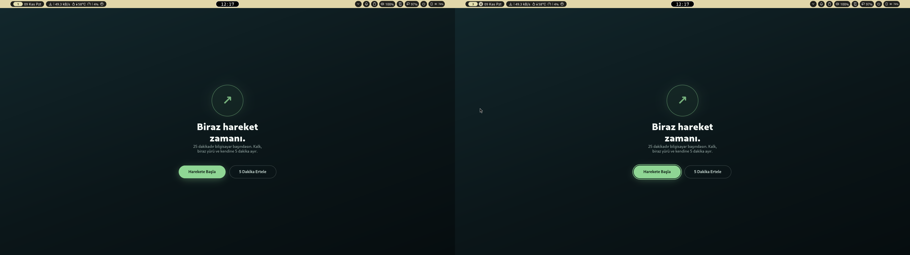

<div align="center">

# 🧍 StandUp

### 25 dakika çalış. Kalk. 5 dakika hareket et.

**Hyprland / Wayland için tam ekran mola hatırlatıcısı.**
Ön uyarı yok, erteleme bahanesi yok — vakit gelince tüm ekranlar senin iyiliğin için kilitlenir.

*Rust + GTK4 · %100 çevrimdışı · telemetri yok · hesap yok · bulut yok*



</div>

---

## Nasıl çalışır?

| | |
|---|---|
| 💻 **25 dk çalışma** | Arka planda sessizce sayar. Sürekli açık pencere yok. |
| 🟢 **Tam ekran hatırlatma** | Tüm monitörlerde aynı anda açılır. İki seçenek var: |
| 🚶 **Harekete Başla** | Ekran kapanır, 5 dakikalık mola başlar. Mola bitince bildirim gelir, yeni döngü başlar. |
| 😴 **5 Dakika Ertele** | Ekran kapanır, tam 5 dakika sonra hatırlatma geri gelir. Çalışma sayacı **sıfırlanmaz**. (`Esc` de aynı işi yapar.) |

Erteleme sayısında sınır yok — ama erteleme asla mola yerine geçmez.

## Öne çıkanlar

- 🖥️ **Çoklu monitör** — hatırlatma her ekranda; birinde tıkladığın anda hepsi kapanır. Monitör takıp çıkarmak uygulamayı çökertmez.
- 🔒 **Kilit ekranına saygılı** — overlay asla kilit ekranının üstüne çıkmaz. Kısa ayrılıkta kaldığın yerden, 5+ dakikalık ayrılıkta taze döngüyle dönersin.
- ⏱️ **Kaymayan zamanlayıcı** — monotonik saat + askıya-alma uyumlu ölçüm; saat değişiklikleri ve CPU yükü sayacı bozmaz.
- 🪶 **Hafif** — yoklama (polling) yok, meşgul bekleme yok; ~9 MB tek binary.
- 🔐 **Tek örnek** — ikinci çalıştırma sessizce çıkar; `standup --quit` ile her zaman kapatılabilir. Kendini kilit ekranı gibi göstermez.

## Kurulum

Arch / CachyOS:

```sh
sudo pacman -S gtk4 gtk4-layer-shell
cargo build --release
install -Dm755 target/release/standup ~/.local/bin/standup
install -Dm644 assets/standup.desktop ~/.local/share/applications/standup.desktop
```

`~/.local/bin` PATH'teyse hazırsın.

## Kullanım

```sh
standup          # başlat (25/5/5 döngüsü, arka planda sessiz)
standup --quit   # durdur
```

Otomatik başlatma (isteğe bağlı, tek yöntem seç):

```sh
standup --install-autostart xdg        # oturum açılışında başla
standup --install-autostart hyprland   # + hyprland.conf'a source satırını kendin ekle
standup --uninstall-autostart          # geri al
```

Mevcut Hyprland yapılandırman asla otomatik değiştirilmez.

## Ayarlar

`~/.config/standup/config.toml` (yoksa varsayılanlar kullanılır):

```toml
work_secs = 1500    # 25 dk
snooze_secs = 300   # 5 dk
break_secs = 300    # 5 dk
```

Bozuk değerler tek tek varsayılana döner + log'a yazılır.

## Geliştirici notları

25 dakikalık döngüyü beklemeden test et:

```sh
./target/debug/standup --work-secs 10 --snooze-secs 10 --break-secs 10
```

Mimari: zamanlayıcı çekirdeği (`src/domain/`) platformdan bağımsız saf Rust'tır — Linux'a özel katman (`src/platform/`: D-Bus kilit/askı takibi, bildirimler, tek-örnek kilidi) ve GTK4 arayüz (`src/ui/`) ayrıdır.

```sh
cargo test   # 25 test: durum makinesi, erteleme, away eşikleri, kilit güvenliği
```

## Lisans

MIT — [LICENSE](LICENSE)
